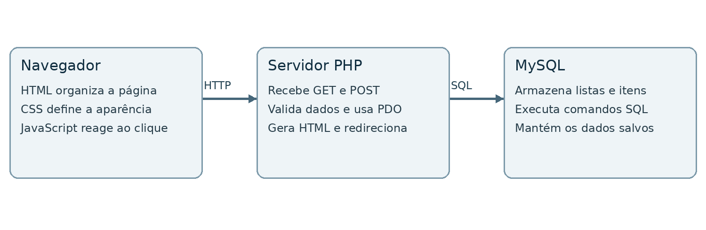
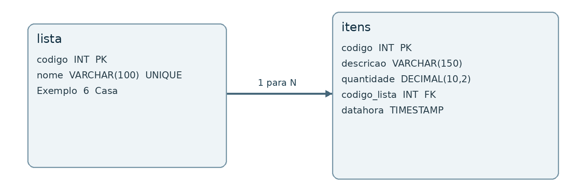
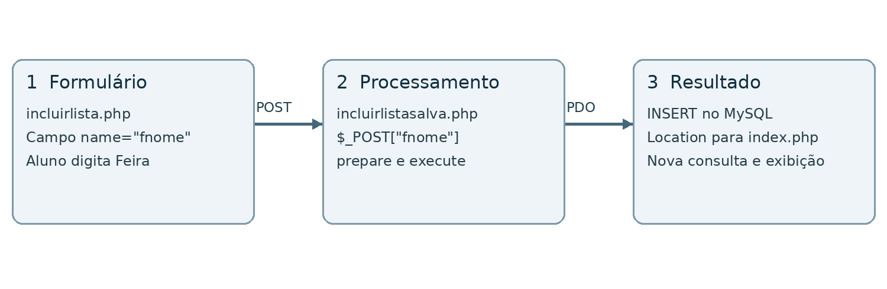

# Tutorial de desenvolvimento web com PHP e MySQL

[Voltar ao README](../README.md) · [Versão em Word](Tutorial_Lista_de_Compras_PHP_MySQL.docx)

Lista de compras com código comentado e validação de dados

Material para alunos iniciantes • DEVS TI 2026 • Versão revisada em 22 de outubro de 2026

Você vai compreender e executar uma aplicação de lista de compras em PHP e MySQL. O roteiro acompanha o código atual: conexão com utf8mb4, validação de entradas, consultas parametrizadas, formulários protegidos e exclusões com transação. Ao final, deverá conseguir seguir um campo do formulário até sua coluna no banco e explicar o funcionamento do CRUD.



*Figura 1  Navegador servidor PHP e banco de dados*

### Como usar este material

Leia com o projeto aberto no editor. Os trechos identificados por arquivo vêm da implementação atual; alguns omitem partes para concentrar a explicação. Consulte o arquivo completo antes de copiar um recorte. Faça os exercícios em um banco local de estudo e registre o resultado de cada operação.

Os comentários em português explicam o motivo das verificações e o papel de cada etapa. As ilustrações representam o funcionamento e o modelo de dados. O tutorial termina com atividades que ampliam o sistema, além das correções já implementadas.

## Sumário

- [1 Roteiro de aprendizagem](#secao-1)
- [2 Navegador servidor e banco de dados](#secao-2)
- [3 Organização dos arquivos](#secao-3)
- [4 Preparando o ambiente de aula](#secao-4)
- [5 Modelando listas e itens](#secao-5)
- [6 Instalando e conferindo as tabelas](#secao-6)
- [7 Conectando o PHP ao MySQL](#secao-7)
- [8 Formulários sessões e envio por POST](#secao-8)
- [9 Cadastrando uma lista](#secao-9)
- [10 Consultando e exibindo os dados](#secao-10)
- [11 Cadastrando itens na lista correta](#secao-11)
- [12 Alterando registros existentes](#secao-12)
- [13 Excluindo com transação](#secao-13)
- [14 Interações e apresentação](#secao-14)
- [15 Validando as entradas no servidor](#secao-15)
- [16 Saída HTML redirecionamento e CSRF](#secao-16)
- [17 Diagnosticando problemas](#secao-17)
- [18 Verificando o CRUD corrigido](#secao-18)
- [19 Exercícios e referências](#secao-19)

<a id="secao-1"></a>

## 1 Roteiro de aprendizagem

| Etapa | Conteúdo | Seções |
| --- | --- | --- |
| Compreender | Navegador servidor e arquivos | 2 e 3 |
| Preparar | Ambiente e conexão | 4 e 7 |
| Modelar | Tabelas e SQL de instalação | 5 e 6 |
| Enviar dados | Formulários POST e sessão | 8 |
| Cadastrar e consultar | INSERT SELECT e associação dos itens | 9 a 11 |
| Modificar | UPDATE DELETE e transação | 12 e 13 |
| Interagir | JavaScript e CSS | 14 |
| Validar e proteger | Regras de entrada escape e CSRF | 15 e 16 |
| Verificar | Diagnóstico testes e exercícios | 17 a 19 |

### Objetivos da prática

Localize o arquivo de uma operação, identifique os campos recebidos e encontre o comando SQL correspondente. Explique por que o filtro WHERE é necessário, como um item pertence a uma lista e por que a validação precisa existir no servidor mesmo quando o HTML já possui required.

### O que mudou na versão corrigida

As melhorias fazem parte do código: a conexão informa charset, todo redirecionamento termina com exit, os registros são buscados antes do HTML e as entradas têm tipo e limite verificados. Nomes e mensagens recebem escape na saída. Exclusões exigem POST e token CSRF, e excluir uma lista confirma ou desfaz as remoções em conjunto.

O arquivo SQL principal agora cria lista e itens. Para instalações antigas que já possuem lista e ainda não possuem itens, há o complemento banco/itens.sql. O README explica quando usar cada arquivo.

<a id="secao-2"></a>

## 2 Navegador servidor e banco de dados

Ao abrir index.php por HTTP, o navegador solicita uma página ao servidor. O PHP consulta o MySQL e monta o HTML da resposta. O navegador apresenta o resultado e carrega o CSS, os ícones e o JavaScript. O banco mantém os registros depois que a página é fechada.


*Figura 2  Responsabilidades das três partes da aplicação*

### As tecnologias do projeto

HTML organiza títulos, listas, links e formulários. CSS define aparência e alinhamento. JavaScript pede confirmação antes de enviar uma exclusão e limpa uma mensagem depois de cinco segundos. PHP recebe requisições, valida dados e executa SQL por meio do PDO.

### Requisição e resposta

GET abre páginas e consulta registros. POST envia os formulários que alteram dados. Depois de uma gravação, redirecionar produz uma resposta HTTP 303, que instrui o navegador a voltar para index.php por GET. Isso separa o envio do formulário da tela de resultado.

### Observe na prática

Na aba Rede das ferramentas do navegador, acompanhe o POST para incluirlistasalva.php e o GET seguinte para index.php. Abra o código fonte recebido: você verá o HTML produzido, não o código PHP que criou a resposta.

<a id="secao-3"></a>

## 3 Organização dos arquivos

| Arquivo | Responsabilidade |
| --- | --- |
| index.php | Consulta listas e itens e apresenta os formulários de exclusão. |
| funcoes.php | Sessão CSRF validação escape buscas e redirecionamento. |
| conexao.php | Cria o PDO e encerra a execução se não houver conexão. |
| acessos.php | Configuração local; acessos.exemplo.php traz valores fictícios. |
| incluirlista.php e incluirlistasalva.php | Apresentam e processam o cadastro de lista. |
| incluiritens.php e incluiritenssalva.php | Apresentam e processam o cadastro de item. |
| alterarlista.php e alterarlistasalva.php | Carregam e salvam a alteração de lista. |
| alteraritem.php e alteraritemsalva.php | Carregam e salvam a alteração de item. |
| excluirlista.php e excluiritem.php | Recebem exclusivamente POST protegido e removem registros. |
| funcoes.js e estilo.css | Controlam as interações e a apresentação. |
| listadecompras.sql e banco/itens.sql | Instalação completa e complemento para banco antigo. |
| testes/validacoes.php | Confere as regras de entrada sem acessar o banco. |

### Um fluxo para cada operação

Abra incluirlista.php e encontre action="incluirlistasalva.php". O primeiro arquivo apresenta o formulário; o segundo valida os valores e faz o INSERT. A separação permite acompanhar o trabalho sem precisar de um framework. require_once carrega as funções compartilhadas uma vez por requisição.

<a id="secao-4"></a>

## 4 Preparando o ambiente de aula

### Ferramentas necessárias

Use PHP 8.1 ou superior, com PDO, pdo_mysql, mbstring e sessões habilitados, e MySQL 8.0.16 ou superior. O tipo never exige PHP 8.1 e o CHECK de quantidade é aplicado pelo MySQL a partir de 8.0.16. O SQL usa a collation utf8mb4_0900_ai_ci. O phpMyAdmin pode auxiliar na importação.

**Comandos para conferir o PHP**

```bash
php -v
php -m
```

### Criar e importar

**Execute em um banco novo de estudo**

```sql
CREATE DATABASE listadecompras CHARACTER SET utf8mb4;
USE listadecompras;
```

Selecione o banco e importe listadecompras.sql pelo phpMyAdmin. O arquivo agora cria as duas tabelas e inclui Casa e Sitio como exemplos de lista. Em um banco antigo com lista já criada e itens ausente, importe somente banco/itens.sql. Não execute os dois arquivos em sequência no mesmo banco novo.

### Configurar e executar

Se acessos.php não existir, copie acessos.exemplo.php para acessos.php e informe suas credenciais locais. Em seguida, abra o terminal na pasta que contém index.php e execute o servidor de desenvolvimento abaixo. O MySQL deve estar ativo separadamente.

**Iniciar o servidor local do PHP**

```bash
php -S 127.0.0.1:8000
```

Abra http://127.0.0.1:8000/index.php. Pressione Ctrl+C no terminal para encerrar o servidor. Abrir os arquivos por file:// não executa PHP. Também é possível usar Apache configurado pelo professor. O servidor embutido destina-se a desenvolvimento, conforme o manual do PHP.

<a id="secao-5"></a>

## 5 Modelando listas e itens

Cada linha de lista representa uma lista de compras. Cada linha de itens representa um produto e sua quantidade. Uma lista pode ter vários itens; cada item pertence a uma lista. Esse relacionamento é chamado de um para muitos.



*Figura 3  Chave primária e vínculo entre lista e itens*

### Identificadores diferentes

lista.codigo é a chave primária da lista. itens.codigo identifica um item, e itens.codigo_lista guarda o identificador da lista à qual ele pertence. Um item de código 15 pode estar associado à lista 6. Esses números não precisam coincidir.

### Regras no banco

AUTO_INCREMENT gera identificadores. UNIQUE em lista.nome impede nomes repetidos. NOT NULL impede o valor SQL NULL. A chave estrangeira verifica se a lista de um item existe. ON DELETE RESTRICT impede apagar uma lista que ainda tenha itens; por isso o processador remove os itens primeiro, dentro de uma transação.

quantidade usa DECIMAL(10,2), com até oito dígitos antes do ponto e dois depois. CHECK (quantidade &gt; 0) reforça no banco a regra também aplicada pelo PHP. datahora recebe CURRENT_TIMESTAMP no cadastro e é atualizada pelo processador de alteração.

<a id="secao-6"></a>

## 6 Instalando e conferindo as tabelas

Este é o SQL de criação de itens presente no arquivo principal e no complemento banco/itens.sql. A tabela lista deve existir antes, com codigo INT como chave primária. Em bancos já preenchidos, compare a estrutura com o professor antes de planejar uma migração.

**Trecho atual de banco/itens.sql**

```sql
CREATE TABLE itens (
  codigo INT NOT NULL AUTO_INCREMENT,
  descricao VARCHAR(150) NOT NULL,
  quantidade DECIMAL(10,2) NOT NULL DEFAULT 1.00,
  codigo_lista INT NOT NULL,
  datahora TIMESTAMP NOT NULL DEFAULT CURRENT_TIMESTAMP,
  PRIMARY KEY (codigo),
  INDEX idx_itens_lista (codigo_lista),
  CONSTRAINT fk_itens_lista FOREIGN KEY (codigo_lista)
    REFERENCES lista (codigo) ON DELETE RESTRICT,
  CONSTRAINT ck_itens_quantidade CHECK (quantidade > 0)
) ENGINE=InnoDB DEFAULT CHARSET=utf8mb4 COLLATE=utf8mb4_0900_ai_ci;
```

### Confirmando a importação

**Consultas para conferir o banco**

```sql
SHOW TABLES;
DESCRIBE lista;
DESCRIBE itens;
SHOW CREATE TABLE itens;
```

Devem aparecer lista e itens. Confira descricao com limite de 150 caracteres, quantidade decimal, codigo_lista e datahora. SHOW CREATE TABLE permite conferir a chave estrangeira e a regra de quantidade positiva. Os códigos de lista não começam necessariamente em 1: o dump preserva exemplos e configura AUTO_INCREMENT a partir de 9.

### Escolhendo o arquivo correto

Instalação nova: importe listadecompras.sql uma única vez. Instalação antiga com somente lista: aplique banco/itens.sql. Instalação com as duas tabelas: confira as colunas, índices, tipos e restrições existentes; o complemento não altera tabelas já criadas e não deve ser usado para substituir dados.

<a id="secao-7"></a>

## 7 Conectando o PHP ao MySQL

conexao.php inclui acessos.php e cria $conn, o objeto PDO usado pelos demais arquivos. As constantes hostname, database, user e password fornecem os valores locais. DB_HOST, DB_PORT, DB_NAME, DB_USER e DB_PASSWORD, quando configuradas no ambiente, permitem usar outro banco sem editar o arquivo local.

**Trecho atual de conexao.php**

```php
// utf8mb4 preserva acentos e emojis na comunicação com o MySQL.
    $dsn = "mysql:host=$servidor;port=$portaBanco;dbname=$nomeBanco;charset=utf8mb4";
    $conn = new PDO($dsn, $usuarioBanco, $senhaBanco, [
        PDO::ATTR_ERRMODE => PDO::ERRMODE_EXCEPTION,
        PDO::ATTR_DEFAULT_FETCH_MODE => PDO::FETCH_ASSOC,
        PDO::ATTR_EMULATE_PREPARES => false,
    ]);
```

### Lendo as opções

A string DSN informa driver, host, porta, nome e charset do banco. utf8mb4 permite representar acentos e emojis. ERRMODE_EXCEPTION transforma falhas SQL em exceções. FETCH_ASSOC faz as linhas retornarem com chaves pelos nomes das colunas. EMULATE_PREPARES false usa a preparação nativa do driver MySQL.

**Tratamento atual da falha de conexão**

```php
} catch (PDOException $e) {
    // Não seguimos a execução com uma conexão inexistente nem exibimos o erro SQL.
    error_log((string) $e);
    http_response_code(500);
    exit('Não foi possível conectar ao banco de dados. Confira a configuração do servidor.');
}
```

Se a conexão falhar, o PHP registra o detalhe no log, responde com HTTP 500 e encerra a execução com uma mensagem simples. Não continua usando uma variável $conn inexistente. Antes de qualquer saída HTML, os cabeçalhos ainda podem ser definidos corretamente.

<a id="secao-8"></a>

## 8 Formulários sessões e envio por POST



*Figura 4  Cadastro passa por formulário processamento e nova consulta*

**Recorte do formulário atual de incluirlista.php**

```html
<form action="incluirlistasalva.php" method="post" class="cadastro">
    <?php campoCsrf(); ?>
    <label for="fnome">Nome da lista</label>
    <input id="fnome" type="text" name="fnome" maxlength="100" required>
    <!-- O botão Salvar envia o formulário. -->
</form>
```

### Entendendo os atributos

action informa o destino; method="post" escolhe o envio no corpo da requisição; name define a chave recebida em $_POST. id e for associam o rótulo ao campo, facilitando foco e navegação. required e maxlength ajudam na interface, enquanto o PHP verifica novamente essas regras.

### Por que existe uma sessão

funcoes.php inicia a sessão antes do HTML. O navegador recebe um cookie para manter a associação com essa sessão. tokenCsrf cria um valor aleatório, e campoCsrf insere esse valor no formulário. validarPost confere o método e compara o token enviado com o token guardado na sessão.

A sessão usada aqui protege os formulários com CSRF; ela não implementa login nem separa dados por usuário. Esta aplicação continua sendo uma base local de ensino. Não confunda POST com criptografia: uma publicação exige HTTPS e um projeto próprio de acesso aos dados.

<a id="secao-9"></a>

## 9 Cadastrando uma lista

incluirlistasalva.php segue quatro etapas: validar a requisição, validar o campo, gravar e redirecionar. O bloco try reúne o fluxo esperado, e catch encaminha a falha para uma resposta controlada.

**Código atual de incluirlistasalva.php**

```php
require_once __DIR__ . '/funcoes.php';
// A validação do servidor complementa as restrições do formulário HTML.
validarPost();

try {
    $nome = validarTexto($_POST['fnome'] ?? null, 'Nome da lista', 100);
    require __DIR__ . '/conexao.php';
    // Os parâmetros mantêm os dados separados do comando SQL.
    $stmt = $conn->prepare('INSERT INTO lista (nome) VALUES (:nome)');
    $stmt->execute(['nome' => $nome]);
    redirecionar('Lista incluída com sucesso!');
} catch (Throwable $e) {
    tratarErro($e);
}
```

### Acompanhando os valores

$_POST['fnome'] recebe o campo enviado pelo HTML. ?? null oferece um valor quando o campo está ausente. validarTexto rejeita tipos incorretos, remove espaços nas extremidades e confere o limite de 100 caracteres. $nome recebe o texto validado.

prepare define o comando com :nome como marcador; execute associa esse marcador ao valor de $nome. Os parâmetros representam dados, sem concatenar o conteúdo do usuário à instrução SQL. O banco gera codigo automaticamente.

### Depois da gravação

redirecionar codifica a mensagem com http_build_query, envia Location com status 303 e executa exit. Se houver nome duplicado, o banco rejeita o INSERT e tratarErro apresenta uma mensagem específica. A página inicial consulta os registros novamente ao receber o GET seguinte.

<a id="secao-10"></a>

## 10 Consultando e exibindo os dados

index.php busca as listas ordenadas por nome e os itens ordenados por descrição. fetchAll devolve arrays; a condição !$listas identifica o resultado vazio. Não usamos rowCount para descobrir quantos registros um SELECT retornou.

**Trecho atual da consulta em index.php**

```php
// Duas consultas atendem todas as listas, evitando uma consulta extra por lista.
    $stmt = $conn->query('SELECT codigo, nome FROM lista ORDER BY nome, codigo');
    $listas = $stmt->fetchAll();
    $stmt = $conn->query(
        'SELECT codigo, descricao, quantidade, codigo_lista, datahora
         FROM itens ORDER BY descricao, codigo'
    );
    $itensPorLista = [];
    foreach ($stmt->fetchAll() as $item) {
        $itensPorLista[$item['codigo_lista']][] = $item;
    }
```

### Agrupando os itens

$itensPorLista é um array de grupos. Em cada repetição, o codigo_lista do item escolhe o grupo. Durante a renderização, o PHP acessa diretamente o grupo da lista atual. Assim, a página usa duas consultas mesmo quando várias listas aparecem, em vez de consultar os itens separadamente para cada lista.

### Exibindo HTML

**Saída atual do nome da lista**

```html
<strong><?= escapar($lista['codigo']) ?> - <?= escapar($lista['nome']) ?></strong>
```

A sintaxe &lt;?= ... ?&gt; imprime o resultado de uma expressão. escapar converte caracteres especiais em entidades HTML para que nomes apareçam como texto. A página usa ul e li corretamente aninhados, sem o fechamento extra de ul que havia na versão anterior.

Uma lista vazia exibe uma orientação para adicionar itens. Se a consulta falhar, index.php registra o erro e responde com HTTP 500, sem tentar renderizar resultados incompletos.

<a id="secao-11"></a>

## 11 Cadastrando itens na lista correta

O link para incluiritens.php envia apenas codigo na URL, montada com http_build_query. O nome exibido no formulário é buscado no banco por buscarLista. Portanto, nomes com aspas ou &amp; não precisam ser enviados na URL e não alteram o funcionamento da navegação.

**Trecho atual de incluiritenssalva.php**

```php
try {
    $codigoLista = validarCodigo($_POST['fcodigolista'] ?? null);
    $descricao = validarTexto($_POST['fdescricao'] ?? null, 'Descrição', 150);
    $quantidade = validarQuantidade($_POST['fquantidade'] ?? null);
    require __DIR__ . '/conexao.php';
    buscarLista($conn, $codigoLista);
    // O campo oculto é validado e a chave estrangeira verifica o vínculo no banco.
    $stmt = $conn->prepare(
        'INSERT INTO itens (descricao, quantidade, codigo_lista)
         VALUES (:descricao, :quantidade, :codigo_lista)'
    );
    $stmt->execute([
        'descricao' => $descricao,
        'quantidade' => $quantidade,
        'codigo_lista' => $codigoLista,
    ]);
```

### O vínculo com a lista

fcodigolista é oculto, mas ainda pode ser alterado por quem envia a requisição. validarCodigo verifica o identificador, buscarLista confere a existência e a chave estrangeira mantém a consistência no banco. A coluna datahora recebe seu valor padrão porque não aparece no INSERT.

### Quantidade e descrição

A descrição deve ter entre 1 e 150 caracteres após trim. A quantidade deve ir de 0.01 até 99999999.99 e ter no máximo duas casas decimais. O campo HTML usa type="number", min, max, step e required. O PHP rejeita valores negativos, zero, notação científica e casas excedentes; não os arredonda silenciosamente.

Cadastre Arroz com quantidade 2 e Leite com 1.50. Confira no banco que os itens têm códigos diferentes e o mesmo codigo_lista. No formulário, use o formato decimal aceito pelo navegador; o valor enviado ao servidor usa ponto.

<a id="secao-12"></a>

## 12 Alterando registros existentes

A alteração usa GET para carregar a tela e POST para salvar. alterarlista.php e alteraritem.php validam codigo e consultam o registro antes de produzir HTML. Se o código estiver ausente, inválido ou não corresponder a um registro, tratarErro redireciona com uma mensagem, sem preencher campos com dados inexistentes.

**Trecho atual de alterarlistasalva.php**

```php
try {
    $codigo = validarCodigo($_POST['fcodigo'] ?? null);
    $nome = validarTexto($_POST['fnome'] ?? null, 'Nome da lista', 100);
    require __DIR__ . '/conexao.php';
    buscarLista($conn, $codigo);
    // WHERE restringe a alteração à lista escolhida, mesmo se o nome não mudar.
    $stmt = $conn->prepare('UPDATE lista SET nome = :nome WHERE codigo = :codigo');
    $stmt->execute(['nome' => $nome, 'codigo' => $codigo]);
    redirecionar('Lista alterada com sucesso!');
```

### Por que buscar antes de atualizar

buscarLista permite identificar uma lista inexistente. Um UPDATE que mantém os mesmos valores pode afetar zero linhas, mesmo quando o registro existe. Por isso não usamos rowCount igual a zero como prova de inexistência nessa alteração.

### Alteração de item

**Trecho atual de alteraritemsalva.php**

```php
// A data registra a modificação; o item continua associado à mesma lista.
    $stmt = $conn->prepare(
        'UPDATE itens SET descricao = :descricao, quantidade = :quantidade,
         datahora = CURRENT_TIMESTAMP WHERE codigo = :codigo'
    );
    $stmt->execute(['descricao' => $descricao, 'quantidade' => $quantidade, 'codigo' => $codigo]);
```

buscarItem usa JOIN para carregar os dados do item e o nome da lista. O UPDATE altera descrição, quantidade e datahora, mantendo codigo_lista. O filtro WHERE restringe a alteração à chave primária escolhida. Sem esse filtro, um UPDATE pode modificar toda a tabela.

Experimente renomear uma lista, salvar novamente sem mudar seu nome e alterar a quantidade de apenas um item. Registre o código antes e depois para demonstrar que você modificou um registro existente.

<a id="secao-13"></a>

## 13 Excluindo com transação

As exclusões usam formulários POST com fcodigo e csrf. O JavaScript pede confirmação antes do envio; no servidor, validarPost impede GET e token inválido. A chave primária identifica o registro, sem depender do nome ou da descrição recebida do navegador.

### Excluir um item

**Trecho atual de excluiritem.php**

```php
// A chave primária identifica o item, sem depender da descrição do navegador.
    $stmt = $conn->prepare('DELETE FROM itens WHERE codigo = :codigo');
    $stmt->execute(['codigo' => $codigo]);
    if ($stmt->rowCount() !== 1) {
        throw new InvalidArgumentException('Item não encontrado.');
    }
```

### Excluir uma lista e seus itens

excluirlista.php abre uma transação e consulta a lista com FOR UPDATE. Se ela não existir, gera um erro controlado. O bloqueio coordena a operação com a chave estrangeira. Depois, remove primeiro os itens e então a lista. Somente após as duas etapas chama commit.

**Parte final da transação em excluirlista.php**

```php
$stmt = $conn->prepare('DELETE FROM itens WHERE codigo_lista = :codigo');
    $stmt->execute(['codigo' => $codigo]);
    $stmt = $conn->prepare('DELETE FROM lista WHERE codigo = :codigo');
    $stmt->execute(['codigo' => $codigo]);
    if ($stmt->rowCount() !== 1) {
        throw new RuntimeException('A lista não pôde ser excluída.');
    }
    $conn->commit();
```

No catch, se a transação ainda estiver ativa, rollBack desfaz as mudanças. Assim, uma falha ao apagar a lista não deixa seus itens removidos pela metade. O código depende de tabelas InnoDB. A confirmação do navegador é uma ajuda de interface; o token e as regras do servidor continuam necessários.

<a id="secao-14"></a>

## 14 Interações e apresentação

Os links de navegação são elementos a com href. Nomes e descrições não são inseridos em onclick. Nos formulários de exclusão, data-confirmar guarda uma mensagem com escape HTML; JavaScript lê esse atributo como texto.

**Confirmação atual de exclusão em funcoes.js**

```javascript
for (const formulario of document.querySelectorAll('form[data-confirmar]')) {
    formulario.addEventListener('submit', (evento) => {
        if (!window.confirm(formulario.dataset.confirmar)) {
            evento.preventDefault(); // Cancelar não envia a exclusão ao servidor.
        }
    });
}
```

Se a resposta à confirmação for Cancelar, preventDefault impede o envio. O servidor continua exigindo POST e CSRF, mesmo se o JavaScript for desativado ou contornado. O script é carregado com defer, então os elementos da página já existem quando os eventos são associados.

**Limpeza atual de mensagem em funcoes.js**

```javascript
function limpamsg() {
    // A mensagem é apagada uma única vez, depois de cinco segundos.
    setTimeout(() => {
        const msg = document.getElementById('msg');
        if (msg) msg.textContent = '';
    }, 5000);
}
```

### CSS válido e leitura

estilo.css usa inline-flex, align-items: center e gap para alinhar texto e ícones. flex-wrap permite que os botões quebrem de linha em telas pequenas. A fonte e o foco visível ajudam a leitura e a navegação pelo teclado. Campos e labels têm vínculos por id e for, e os botões de ícone têm nomes acessíveis.

Inspecione a página no navegador e compare uma tela larga com uma tela estreita. Procure sobreposição de controles, nomes longos e navegação usando Tab.

<a id="secao-15"></a>

## 15 Validando as entradas no servidor

funcoes.php concentra as regras usadas por todos os processadores. Essa centralização evita limites diferentes entre cadastrar e alterar. As funções retornam valores válidos ou lançam InvalidArgumentException, tratada por tratarErro.

**Validação atual de texto**

```php
function validarTexto($valor, string $campo, int $limite): string
{
    if (!is_string($valor) || !mb_check_encoding($valor, 'UTF-8')) {
        throw new InvalidArgumentException($campo . ': informe um texto válido.');
    }
    $texto = trim($valor);
    if ($texto === '' || mb_strlen($texto, 'UTF-8') > $limite) {
        throw new InvalidArgumentException($campo . ': use de 1 a ' . $limite . ' caracteres.');
    }
    return $texto;
}
```

### Texto e identificador

is_string rejeita arrays enviados no lugar do campo. mb_check_encoding confere UTF-8, trim remove espaços nas extremidades e mb_strlen mede caracteres sem confundir acentos com vários bytes. validarCodigo aceita somente inteiros positivos no intervalo do INT usado no banco.

### Quantidade sem arredondamento indevido

validarQuantidade usa uma expressão regular para conferir o formato decimal e o limite de casas. Depois completa as casas com str_pad, mantendo uma string para gravar no DECIMAL. Uma entrada como 1.001 deve ser rejeitada, não transformada em 1.00. O navegador ajuda, mas a regra PHP vale para toda requisição.

**Execute as verificações sem banco**

```bash
php testes/validacoes.php
```

O arquivo de teste exercita limites, acentos, arrays, texto inválido e escape. Leia seus casos e acrescente novos exemplos quando mudar uma regra. Os testes de validação não substituem conferir o formulário, o SQL e a integração completa.

<a id="secao-16"></a>

## 16 Saída HTML redirecionamento e CSRF

### Cada contexto tem uma função

**Escape e redirecionamento atuais em funcoes.php**

```php
function escapar($valor): string
{
    // Escape para texto HTML e atributos entre aspas; não é um escape SQL.
    return htmlspecialchars((string) $valor, ENT_QUOTES | ENT_SUBSTITUTE, 'UTF-8');
}

function redirecionar(string $mensagem): never
{
    // A mensagem é codificada para a URL; 303 leva o navegador de volta por GET.
    header('Location: index.php?' . http_build_query(['msg' => $mensagem]), true, 303);
    exit; // header sozinho não interrompe o processamento.
}
```

escapar é usado ao imprimir texto e atributos HTML delimitados por aspas. http_build_query codifica valores para a URL. prepare e execute mantêm os valores separados da estrutura SQL. Uma dessas funções não substitui as outras: elas atuam em contextos diferentes.

### Conferindo a origem do formulário

tokenCsrf usa random_bytes para gerar um segredo aleatório por sessão. campoCsrf insere o valor em um campo oculto. validarPost exige POST e usa hash_equals para comparar o token enviado com o da sessão. GET recebe 405 e Allow: POST; token ausente ou incorreto recebe 403.

### O papel de exit

header define um cabeçalho, mas não encerra o PHP. redirecionar sempre chama exit para impedir que outro comando execute depois da resposta. As páginas que carregam registros fazem isso antes do HTML, eliminando o redirecionamento malformado e a saída antecipada de alterarlista.php.

### Credenciais e limites de acesso

Use acessos.exemplo.php como modelo e mantenha a configuração local fora de publicações. acessos.php já era rastreado no projeto; .gitignore evita adicionar cópias novas, mas não remove um arquivo do histórico. Antes de publicar, revise esse rastreamento e troque qualquer senha real anteriormente divulgada. O sistema não possui autenticação nem divisão por usuário.

<a id="secao-17"></a>

## 17 Diagnosticando problemas

| Sintoma | Verificação inicial |
| --- | --- |
| PHP não executa | Abra uma URL HTTP do servidor PHP, não file://. |
| Falha de conexão | Confira serviço MySQL host porta usuário senha e banco. |
| could not find driver | Habilite pdo_mysql no PHP que atende a página. |
| Função mb não encontrada | Habilite mbstring nesse mesmo PHP. |
| Tabela itens ausente | Banco novo usa o SQL completo; banco antigo pode usar banco/itens.sql. |
| Nome de lista repetido | Escolha outro nome; o índice UNIQUE protege a regra. |
| Método não permitido | Use o formulário POST da aplicação; links GET antigos de exclusão não são aceitos. |
| Formulário inválido | Recarregue o formulário e confira se o navegador mantém cookies da sessão. |
| Erro técnico na operação | Leia o log do PHP e confira o SQL e os parâmetros. |
| Unknown collation | Confira a versão do MySQL; o dump usa utf8mb4_0900_ai_ci. |

### Investigação por etapas

Reproduza uma ação e registre URL, método, campos enviados e resposta. Confira a aba Rede no navegador, depois o log do PHP e, por fim, faça uma consulta de leitura no banco. Mude uma causa por vez e repita a mesma ação para verificar a correção.

Os detalhes SQL são registrados com error_log em vez de serem anexados à URL. As mensagens apresentadas não substituem o diagnóstico do servidor. Após adaptar um banco antigo, confira se ele tem a chave estrangeira, o CHECK de quantidade e os tipos esperados, pois CREATE TABLE não migra uma tabela já existente.

<a id="secao-18"></a>

## 18 Verificando o CRUD corrigido

Use um banco de estudo e crie uma lista própria para os testes. O cadastro e a alteração devem terminar em redirecionamento 303. Cancelar uma confirmação de exclusão deve deixar a página e os registros intactos.

| Ação | Resultado esperado |
| --- | --- |
| Criar Aula 🛒 Pães & leite | Nome preservado e exibido como texto. |
| Cadastrar Arroz 2 e Leite 1.50 | Itens diferentes associados à mesma lista. |
| Salvar nome já existente | Mensagem de duplicidade sem nova gravação. |
| Enviar nome só com espaços ou campo array | Entrada rejeitada pelo servidor. |
| Enviar quantidade 0 negativa ou 1.001 | Entrada rejeitada sem arredondamento. |
| Renomear lista e alterar quantidade | Apenas os registros escolhidos mudam. |
| Salvar o mesmo nome novamente | Operação aceita sem confundir ausência de mudança com inexistência. |
| Chamar exclusão por GET | Resposta 405 e nenhum registro excluído. |
| POST sem token ou com token de outra sessão | Resposta 403 e nenhuma gravação. |
| Excluir lista com seus itens | Lista e itens removidos juntos; demais listas preservadas. |

### Conferir no banco

**Consultas de leitura para acompanhar a prática**

```sql
SELECT codigo, nome FROM lista ORDER BY nome;
SELECT codigo, descricao, quantidade, codigo_lista, datahora
FROM itens ORDER BY codigo_lista, codigo;
```

Para testar uma falha na segunda exclusão, use apenas um banco descartável e orientação do professor: force a falha e confirme que rollBack preserva tanto a lista quanto os itens. Não simule essa condição em um banco com dados de uso real.

<a id="secao-19"></a>

## 19 Exercícios e referências

### Atividades para continuar

1. Trace o percurso de fnome até lista.nome e de fcodigo até o WHERE do UPDATE. Explique onde ocorrem validação, conexão, SQL e redirecionamento.

2. Acrescente uma busca por nome de lista com parâmetros SQL. Verifique nomes com aspas, acentos e &amp; e apresente como o filtro se combina com a ordenação.

3. Implemente um campo comprado nos itens. Planeje a alteração do banco, o formulário POST com CSRF, a validação e a persistência após recarregar.

4. Acrescente paginação para listas e itens em um banco com muitos registros. Explique por que fetchAll é simples para a aula, mas exige planejamento para grandes volumes.

5. Prepare uma migração para um banco antigo que já possui itens. Compare tipos e restrições antes de propor ALTER TABLE e defina como testar sem perder dados.

### Revisão dos conceitos

CRUD corresponde a INSERT, SELECT, UPDATE e DELETE. O navegador envia dados, o PHP verifica as regras e o MySQL persiste. WHERE escolhe o alvo; codigo_lista mantém o vínculo. Escape HTML, parâmetros SQL e token CSRF resolvem problemas diferentes. Uma transação trata várias gravações como uma unidade.

### Referências oficiais

Código estudado: arquivos atuais deste repositório, especialmente funcoes.php, conexao.php, index.php, formulários e processadores, banco/itens.sql e testes/validacoes.php. Consulte os manuais oficiais abaixo para aprofundar os conceitos.

- [PHP PDO prepare](https://www.php.net/manual/en/pdo.prepare.php)

- [PHP header](https://www.php.net/manual/en/function.header.php)

- [PHP htmlspecialchars](https://www.php.net/manual/en/function.htmlspecialchars.php)

- [PHP sessões](https://www.php.net/manual/en/book.session.php)

- [PHP rowCount](https://www.php.net/manual/en/pdostatement.rowcount.php)

- [MySQL chaves estrangeiras](https://dev.mysql.com/doc/refman/8.4/en/create-table-foreign-keys.html)

- [MySQL CHECK](https://dev.mysql.com/doc/refman/8.4/en/create-table-check-constraints.html)
